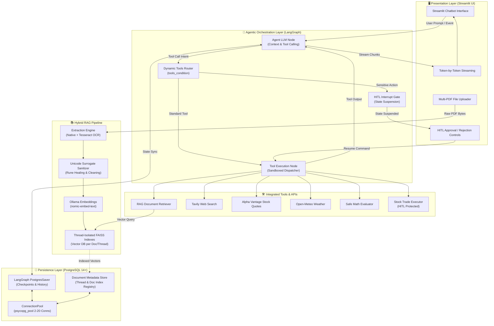
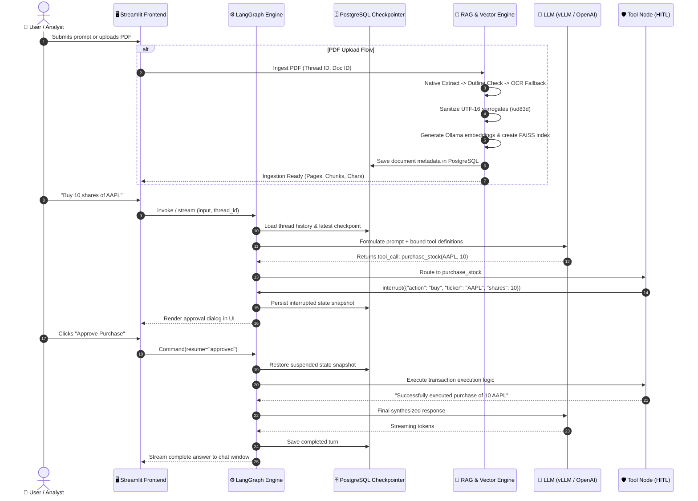

# 🤖 Production-Grade Agentic Chatbot with LangGraph, PostgreSQL & Hybrid RAG

<div align="center">

[](https://www.python.org/)
[](https://github.com/langchain-ai/langgraph)
[](https://www.postgresql.org/)
[](https://github.com/facebookresearch/faiss)
[](https://ollama.ai/)
[](https://streamlit.io/)

**An enterprise-ready, stateful conversational AI agent featuring multi-turn conversation persistence, resilient multi-PDF Retrieval-Augmented Generation (RAG) with OCR fallback, Human-in-the-Loop (HITL) approval workflows, and token-by-token streaming.**

[System Architecture](#-system-architecture) •
[High-Level Architecture](#-high-level-architecture) •
[Tech Stack](#-tech-stack) •
[Key Engineering Highlights](#-key-engineering-highlights--problem-solving) •
[Installation & Quickstart](#-installation--quickstart) •
[Test Coverage](#-test-coverage--validation)

</div>

---

## 📌 Executive Summary

Modern enterprise agentic systems require far more than simple prompt chaining—they demand **durable state persistence**, **fault-tolerant tool execution**, **governance over sensitive operations**, and **rock-solid ingestion pipelines**. 

This repository delivers a modular, production-grade conversational AI architecture powered by **LangGraph** and **PostgreSQL**. Designed to handle real-world deployment challenges, it incorporates:
- **Durable Checkpointing:** Full conversation state and thread recovery backed by a thread-safe PostgreSQL connection pool (`psycopg_pool`).
- **Resilient Multi-PDF RAG:** Thread-scoped document isolation, dual persistence (PostgreSQL + local manifest), 3-tier extraction fallback (native text $\rightarrow$ vector outline check $\rightarrow$ Tesseract OCR), and automatic UTF-16 surrogate sanitization.
- **Human-in-the-Loop (HITL) Governance:** Interactive execution suspension (`interrupt()`) for high-stakes transactions (e.g., financial trades) with dynamic Streamlit resume controls.
- **Enterprise-Grade Modularity:** Strict separation of concerns across domain layers (`agent/`, `database/`, `services/`, `storage/`, `tools/`).

---

## 🏗️ High-Level Architecture

The following diagram illustrates how users interact with the system and how queries flow through the presentation, orchestration, persistence, and external service layers:



---

## 🔬 Detailed System Architecture & Execution Lifecycle



---

## 💻 Tech Stack

| Domain | Technology | Version | Purpose & Architectural Justification |
| :--- | :--- | :--- | :--- |
| **Agent Orchestration** | **LangGraph** | `^0.2.6` | Cycles, branching, checkpointing, and `interrupt()` primitives for stateful workflows. |
| **Agent Core** | **LangChain Core** | `^0.3.7` | Standardized message schemas (`AIMessage`, `HumanMessage`, `ToolMessage`) and model abstractions. |
| **Frontend Framework** | **Streamlit** | `^1.38.0` | Reactive web interface with real-time SSE token streaming, session state, and HITL approval dialogs. |
| **State Persistence** | **PostgreSQL** | `14+` | Production ACID checkpointer storing conversation threads, snapshots, and document metadata. |
| **Database Driver** | **Psycopg 3 (`psycopg_pool`)** | `^3.2.1` | High-performance asynchronous/synchronous PostgreSQL connection pooling to eliminate pipeline collisions. |
| **Vector Database** | **FAISS (CPU)** | `^1.8.0` | Extremely fast in-memory and on-disk dense vector similarity search per conversation thread. |
| **Embedding Engine** | **Ollama (`nomic-embed-text`)** | Local / API | High-dimensional (768-dim) dense embeddings running locally with zero cloud API costs. |
| **LLM Inference** | **vLLM / OpenAI API** | Compatible | OpenAI-compatible high-throughput inference engine supporting structured tool calling and streaming. |
| **PDF Extraction** | **PyPDF** | `^4.3.1` | Fast native PDF text and metadata parser for selectable digital documents. |
| **OCR Fallback** | **Tesseract OCR / PyPDFium2** | `5.x / ^0.29` | High-accuracy raster rendering and optical character recognition for scanned/outlined PDFs. |
| **External APIs** | **Tavily / Alpha Vantage** | Latest | Up-to-date web search grounding and real-time financial market quotes. |
| **Testing & Quality** | **Python `unittest` / Mock** | Built-in | Complete automated unit, regression, multi-PDF stress, and live integration test coverage. |

---

## 🎯 Key Engineering Highlights & Problem-Solving

### 1. Concurrency Fix: PostgreSQL Pipeline Mode Collisions
- **The Problem:** In high-concurrency environments, LangGraph's streaming Pregel engine opened asynchronous pipeline mode transactions while Streamlit's sidebar was querying thread history on the same raw database connection, throwing:
  `psycopg.OperationalError: cannot enter pipeline mode; connection not idle`
- **The Solution:** Engineered a thread-safe connection pool using `psycopg_pool.ConnectionPool` (2–20 connections) in [`database/postgres.py`](file:///d:/Agentic-Chatbot-using-LangGraph/database/postgres.py). All components lease isolated connections through a clean context manager pattern, completely preventing pipeline lockups.

### 2. Multi-PDF Isolation & Windows File-Locking (`WinError 5`)
- **The Problem:** When users uploaded multiple PDFs sequentially in the same chat thread, file-descriptor leaks during image rendering and shared temporary paths triggered `[WinError 5] Access is denied` during file rename/move operations on Windows.
- **The Solution:**
  1. Built thread-isolated document workspaces under `faiss_db/<thread_id>/documents/<document_id>/`.
  2. Implemented an atomic ingestion pipeline with deterministic temporary paths, garbage collection triggers, and bounded retry loops with exponential backoff in [`services/pdf_ingestion_service.py`](file:///d:/Agentic-Chatbot-using-LangGraph/services/pdf_ingestion_service.py).
  3. Enabled dual persistence: document metadata is recorded both in PostgreSQL (`document_metadata` table) and in a local thread manifest (`documents.json`), guaranteeing zero data loss.

### 3. Unicode Surrogate Pair Healing (`\ud83d`)
- **The Problem:** Extracted text from corporate PDFs containing complex fonts, icons, or emojis often contained unpaired or malformed UTF-16 surrogate codepoints (e.g., `\ud83d`), causing downstream crashes:
  `UnicodeEncodeError: 'utf-8' codec can't encode character '\ud83d': surrogates not allowed`
- **The Solution:** Created a dedicated `sanitize_unicode()` engine in [`tools/pdf/extractor.py`](file:///d:/Agentic-Chatbot-using-LangGraph/tools/pdf/extractor.py) using low-level regex patterns. It automatically recombines valid high/low surrogate pairs into correct UTF-8 runes (emojis, mathematical symbols) and sanitizes orphaned half-surrogates and null bytes.

### 4. Zero-Text Detection & Three-Tier OCR Fallback
- **The Problem:** Vector-outlined slide decks (such as Canva/Figma exports or scanned receipts) return 0 characters via standard PDF parsers, leading the model to hallucinate or report an empty document.
- **The Solution:** Implemented a 3-tier fallback strategy:
  1. *Tier 1:* High-speed native digital extraction via `pypdf`.
  2. *Tier 2:* Text density heuristic verification (checks if character count per page falls below threshold).
  3. *Tier 3:* High-resolution rasterization (150–200 DPI via `pypdfium2`) followed by Tesseract OCR processing, converting outlined glyphs into selectable text with zero user friction.

### 5. Multi-Document Smart Routing & Context Synthesis
- **The Problem:** When multiple documents exist in a conversation, naive RAG either searches only the latest PDF or merges everything and dilutes the semantic signal.
- **The Solution:** Developed query-aware multi-document routing in [`tools/rag/retrieval.py`](file:///d:/Agentic-Chatbot-using-LangGraph/tools/rag/retrieval.py). The retriever identifies target documents from user queries (e.g., *"summarize the second document"*, *"compare doc A with doc B"*), searches targeted indexes, or performs weighted cross-document reciprocal rank fusion when broad synthesis is required.

---

## 📂 Repository Directory Layout

The codebase strictly adheres to clean architecture principles:

```text
Agentic-Chatbot-using-LangGraph/
│
├── app_hitl_postgres.py                  # Production Streamlit UI (Streaming, Uploads, HITL)
├── agentic_chatbot_hitl_backend_postgres.py  # LangGraph StateGraph facade with ConnectionPool
├── requirements.txt                      # Pinned production dependencies
├── .env.example                          # Sanitized environment template
├── .gitignore                            # Comprehensive gitignore (zero secrets/DBs committed)
├── README.md                             # Comprehensive project documentation
│
├── agent/                                # Core LangGraph State Machine
│   ├── state.py                          # ChatState TypedDict with add_messages reducer
│   ├── prompts.py                        # System instructions and dynamic tool prompts
│   ├── tool_registry.py                  # Central tool registry mapping
│   ├── routing.py                        # Conditional tool edge routing (tools_condition)
│   ├── nodes.py                          # Agent and Tool Node definitions
│   └── graph.py                          # Compiled StateGraph with PostgresSaver checkpointer
│
├── app/                                  # App Configuration & Lifecycle Singletons
│   ├── config.py                         # Typed settings dataclass & URL normalizers
│   ├── dependencies.py                   # Service singletons (LLM, Embeddings, DB pool)
│   └── logging_config.py                 # Structured application logging
│
├── database/                             # Persistence & Storage Drivers
│   ├── postgres.py                       # Thread-safe psycopg_pool.ConnectionPool
│   ├── checkpointing.py                  # PostgresSaver checkpointer & thread manager
│   └── document_metadata_db.py           # PostgreSQL document_metadata CRUD operations
│
├── services/                             # Business Logic & Ingestion Services
│   ├── llm_service.py                    # Model initialization and tool binding
│   ├── embedding_service.py              # Ollama reachability and health checks
│   ├── pdf_ingestion_service.py          # Atomic PDF extraction, OCR fallback, and FAISS indexing
│   ├── document_service.py               # Thread-scoped document discovery & retrieval assembly
│   └── conversation_service.py           # Thread listing and checkpoint state inspection
│
├── storage/                              # Storage Abstraction Layer
│   ├── paths.py                          # Path resolution and thread sanitization
│   ├── document_metadata.py              # Dual persistence: PostgreSQL + thread manifest
│   └── faiss_store.py                    # FAISS vector store loading and serialization
│
├── tools/                                # Modular Tool Packages (Isolated & Unit-Tested)
│   ├── calculator/                       # Safe AST mathematical evaluation
│   ├── stock_price/                      # Alpha Vantage real-time financial quotes
│   ├── purchase_stock/                   # HITL stock trade simulation with interrupt()
│   ├── weather/                          # Real-time meteorological data via Open-Meteo
│   ├── search/                           # Tavily web search integration
│   ├── rag/                              # Multi-document vector search & smart retrieval
│   └── pdf/                              # PDF text extraction, OCR engine, and Unicode sanitizer
│
├── scripts/                              # Operational, Diagnostic & Audit CLI Utilities
│   ├── check_ollama.py                   # Ollama connection and embedding model probe
│   ├── check_postgres.py                 # PostgreSQL connection and checkpoint inspector
│   ├── inspect_conversation.py           # CLI thread history inspector
│   └── security_audit.py                 # Secret, token, and credential scanner
│
└── tests/                                # Automated Test Suites
    ├── test_rag_postgres.py              # Integration tests for RAG indexing & persistence
    ├── test_multi_pdf_upload.py          # Multi-PDF sequential upload & isolation test
    ├── test_ollama_health.py             # Diagnostic tests for Ollama health check
    ├── test_csm_and_state_diagnostics.py # Scanned/vector-drawn PDF diagnostics with OCR
    └── test_full_workflow_live.py        # End-to-end live LLM & RAG workflow verification
```

---

## ⚡ Installation & Quickstart

### 1. Prerequisites
- **Python**: 3.10 to 3.12 (Python 3.12 recommended)
- **PostgreSQL**: 14+ running locally or in Docker
- **Ollama**: Running locally with `nomic-embed-text`
- **LLM Server**: OpenAI-compatible server (vLLM, Ollama, LM Studio, or OpenAI API)
- **Tesseract OCR** (Optional, recommended for scanned documents)

### 2. Clone & Setup Environment
```bash
git clone https://github.com/Hetgandhi25/agentic-chatbot-langgraph.git
cd agentic-chatbot-langgraph

# Create virtual environment
python -m venv .venv

# Activate virtual environment
# Windows:
.venv\Scripts\activate
# Linux/macOS:
source .venv/bin/activate

# Install dependencies
pip install -r requirements.txt
```

### 3. Configure Environment Variables
Copy `.env.example` to `.env`:
```bash
cp .env.example .env
```
Update `.env` with your local settings:
```ini
# OpenAI-compatible LLM Inference Endpoint (vLLM, Ollama, LM Studio, etc.)
VLLM_BASE_URL=http://localhost:8000/v1
VLLM_API_KEY=your_vllm_api_key_or_EMPTY
VLLM_MODEL=your_model_name

# Ollama Local Embeddings (nomic-embed-text)
OLLAMA_BASE_URL=http://127.0.0.1:11434
OLLAMA_EMBEDDING_MODEL=nomic-embed-text

# External Tools (Optional)
TAVILY_API_KEY=your_tavily_api_key
ALPHA_VANTAGE_API_KEY=your_alpha_vantage_api_key
OPENWEATHER_API_KEY=your_openweather_api_key

# PostgreSQL Connection Settings
POSTGRES_HOST=localhost
POSTGRES_PORT=5432
POSTGRES_DB=agentic_chatbot
POSTGRES_USER=postgres
POSTGRES_PASSWORD=your_secure_password
```

### 4. Verify System Health
Run the built-in diagnostic scripts to verify database, embedding, and security status:
```bash
# 1. Verify Ollama embedding model availability
python scripts/check_ollama.py

# 2. Verify PostgreSQL connection and checkpoint tables
python scripts/check_postgres.py

# 3. Verify zero secrets or private keys exist in the repository
python scripts/security_audit.py
```

### 5. Launch the Application
```bash
streamlit run app_hitl_postgres.py
```
Open **`http://localhost:8501`** in your browser.

---

## 🧪 Test Coverage & Validation

The project includes an extensive automated test suite covering unit functionality, edge cases, concurrent uploads, and live workflow executions:

```bash
# Run all modular tool unit tests (Calculator, Search, Stock, Weather, RAG, PDF)
python -m unittest discover -s tools -v

# Run multi-PDF sequential upload stress & thread isolation tests
python -m unittest tests/test_multi_pdf_upload.py -v

# Run PostgreSQL RAG retrieval and persistence tests
python -m unittest tests/test_rag_postgres.py -v

# Run Ollama embedding health and timeout diagnostics
python -m unittest tests/test_ollama_health.py -v

# Run OCR fallback diagnostics on vector-drawn PDFs
python tests/test_csm_and_state_diagnostics.py

# Run live end-to-end integration test (LLM + Tools + PostgresSaver + HITL)
python tests/test_full_workflow_live.py
```

---

## 🛡️ Security & Privacy Assurance

- **Zero Secrets Tracked:** Audited via `scripts/security_audit.py`—ensuring zero API keys, passwords, database URLs, or private tokens are tracked in Git history.
- **Strict Data Segregation:** FAISS indexes and document metadata are isolated by `thread_id` and `document_id`.
- **AST-Based Math Evaluation:** The calculator tool uses Abstract Syntax Tree (`ast`) traversal instead of dangerous `eval()`, preventing remote code execution (RCE).
- **Execution Governance:** High-stakes transactional tools require explicit user approval via LangGraph interrupts before state changes can occur.

---

## 📄 License

This project is licensed under the **Apache 2.0 License** - see the [LICENSE](LICENSE) file for details.
